# 🔍 Code Detective: an agent that detects and explains terminal errors

An AI agent that sits on PowerShell. When a command fails, **a window pops up by itself** on the side of the screen and explains, in plain language, what happened and in which file and line.
Then it asks: **"I'll fix it myself"** (you get a hint) or **"Give me the solution"** (you get the corrected code). **The agent never changes files by itself.**

Built with **LangGraph**, **LangChain**, **Gemini** and **LangSmith**.

[גרסה בעברית](README.md)

---

## 🚀 Before you start: installing on a new computer

> The project works **on Windows only** and needs **Python 3.10+** ([download](https://www.python.org/downloads/); during setup check *Add python.exe to PATH*).

`requirements.txt` only installs the Python packages. For the agent to work you need to do a few more things **once**:

| # | What | Why |
|---|---|---|
| 1 | Virtual environment and packages | so you get exactly the same packages and versions |
| 2 | A `.env` file with **your own** Gemini key | keys are never uploaded to GitHub |
| 3 | Allow PowerShell to run your profile | on many computers it is blocked by default |
| 4 | Add the Code Detective lines to the profile | they record every PowerShell window and start the agent |

### 1️⃣ Virtual environment and packages
Open PowerShell in the project folder and run:
```powershell
python -m venv .venv
.venv\Scripts\activate
pip install -r requirements.txt
```

### 2️⃣ The `.env` file
Create a file named `.env` in the project folder:
```
GOOGLE_API_KEY=your-key
LANGSMITH_TRACING=false
```
- **Free Gemini key:** [aistudio.google.com](https://aistudio.google.com) → Get API key.
- **LangSmith is optional** (it only stores traces). To use it, add `LANGSMITH_TRACING=true`, `LANGSMITH_API_KEY=...` and `LANGSMITH_PROJECT=code-detective`.

### 3️⃣ Allow PowerShell to run the profile
```powershell
Set-ExecutionPolicy -Scope CurrentUser RemoteSigned
```
Answer `Y`. This allows scripts created on this computer, for your user only.

### 4️⃣ The Code Detective lines in the profile
```powershell
if (-not (Test-Path $PROFILE)) { New-Item -Path $PROFILE -ItemType File -Force }
notepad $PROFILE
```
Paste these lines in Notepad and save. **If the project is not in `Downloads\code-detective`,** change the `$ProjectDir` line to the project's folder:

```powershell
# ================= Code Detective =================
$DetectiveDir = "$HOME\detective"
$ProjectDir   = "$HOME\Downloads\code-detective"

# 1) Record this PowerShell window to its own log file
New-Item -ItemType Directory -Force -Path "$DetectiveDir\logs" | Out-Null
$logFile = "$DetectiveDir\logs\session-$(Get-Date -Format 'yyyyMMdd-HHmmss')-$PID.log"
Start-Transcript -Path $logFile | Out-Null

# 2) Start the agent in the background (only one copy runs)
$app = "$ProjectDir\detective_app.py"
$pythonw = "$ProjectDir\.venv\Scripts\pythonw.exe"
if ((Test-Path $app) -and (Test-Path $pythonw)) {
    Start-Process -FilePath $pythonw -ArgumentList "`"$app`"" -WorkingDirectory $ProjectDir -WindowStyle Hidden
}
# ==================================================
```

### ✅ Check
1. Close all PowerShell windows and open a **new** one.
2. Wait about 10 seconds (the agent loads in the background).
3. Run `python -c "1/0"`. After a second or two the Code Detective window should pop up on the right side of the screen.

> If it does not, the agent's log is at `notepad $HOME\detective\app.log`.

---

## 🧭 How it works

| Step | What happens |
|---|---|
| ⌨️ PowerShell | You work as usual, without changing any command. The profile records every window to its own log file (`Start-Transcript`) |
| 👀 Watcher (`watcher.py`) | Reads the log files every quarter second. A command is finished when a new `PS ...>` line appears, or after one second without new output |
| 🧠 Graph (`graph.py`) | Detects whether there is an error, finds the file and line, reads the code, explains, and suggests a fix |
| 🪟 Window (`detective_app.py`) | Pops up as soon as an error is detected with "analyzing...", and fills in the explanation when it is ready |

---

## 🗺️ The graph

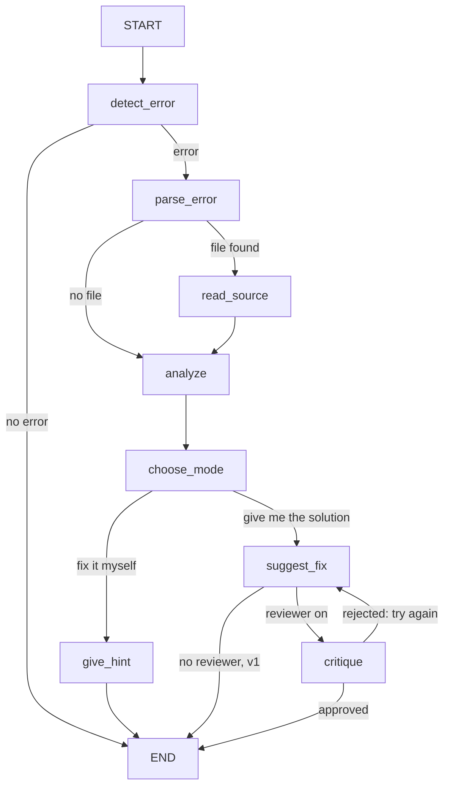

| Node | What it does | Model? |
|---|---|---|
| `detect_error` | decides whether the output contains an error, by the shapes of real error messages | no, code |
| `parse_error` | finds the file and line in the traceback with a regex | no, code |
| `read_source` | reads 5 lines before and after the failing line | no, code |
| `analyze` | error type, root cause, simple explanation | ✅ |
| `choose_mode` | ✋ `interrupt`: stops and asks: myself or solution | no |
| `give_hint` | a hint that points to the right place without giving the answer | ✅ |
| `suggest_fix` | full fix: file, line, "now written", "change to", and why it works | ✅ |
| `critique` | a reviewer that checks the fix and sends it back if it is not good | ✅ |

---

## ✅ How the project meets the requirements

| Requirement | Where |
|---|---|
| Use LangGraph | `graph.py`: a `StateGraph` with 8 nodes |
| Conditional branch | 3 branches: after `detect_error` (error or not), after `parse_error` (file or not), after `choose_mode` (hint or solution) |
| Loop | `critique → suggest_fix` when the reviewer rejects, limited by `max_fix_attempts` so the loop is never infinite |
| interrupt / human-in-the-loop | `choose_mode` stops with `interrupt()`, continues with `Command(resume=...)`. The checkpointer is `MemorySaver` |
| Dataset + evaluation in LangSmith, before and after | `create_dataset.py` (18 examples), `evaluators.py` (5 evaluators), `run_experiment.py` (v1, v2, v3) |
| README with traces and an insight | this document 🙂 |

> 💡 **Design decision:** the agent **does not fix things by itself.** The whole point is to understand the error, not just make it disappear. So I decide: a hint when I want to try myself, and a full solution when I'm stuck.

---

## 🎥 Traces from LangSmith

### ✋ The interrupt in action
The graph stops at `choose_mode` and asks. Here `2` (solution) was chosen, so it continued to `suggest_fix` and `critique`. A command without an error stops right after `detect_error`.

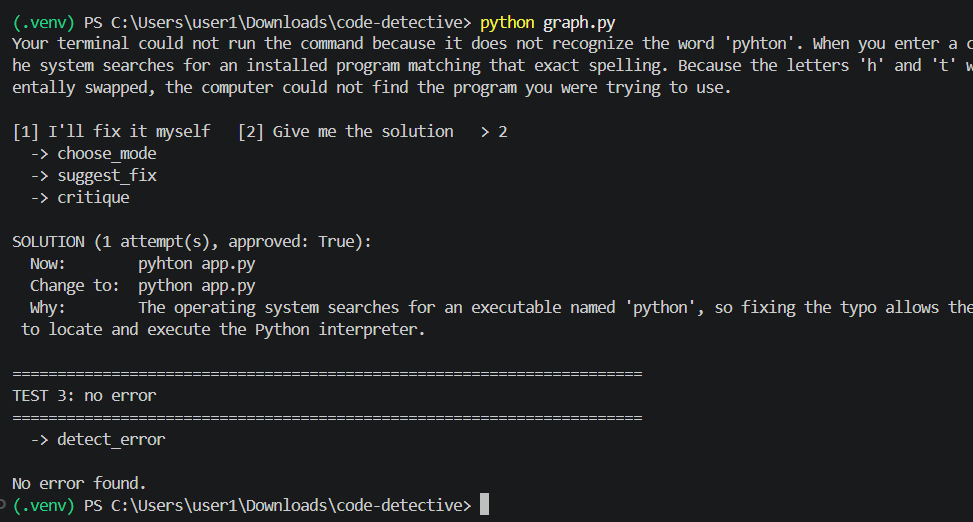

### Every pause splits a run into two traces
The second trace starts from `{"goto":[], ..., "resume": ...}`, which is the `Command(resume=...)` carrying my choice, and the graph continues from exactly the same point.

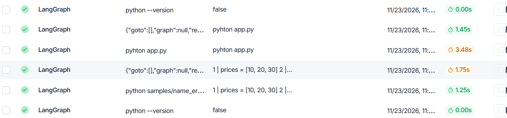

### 🌿 The branch: `read_source`
A file was found, so the graph went through `read_source`. In `code_snippet` you can see `>> 4` marking the failing line. Almost all of the time goes to the model calls (✦), while the other nodes take 0 seconds.

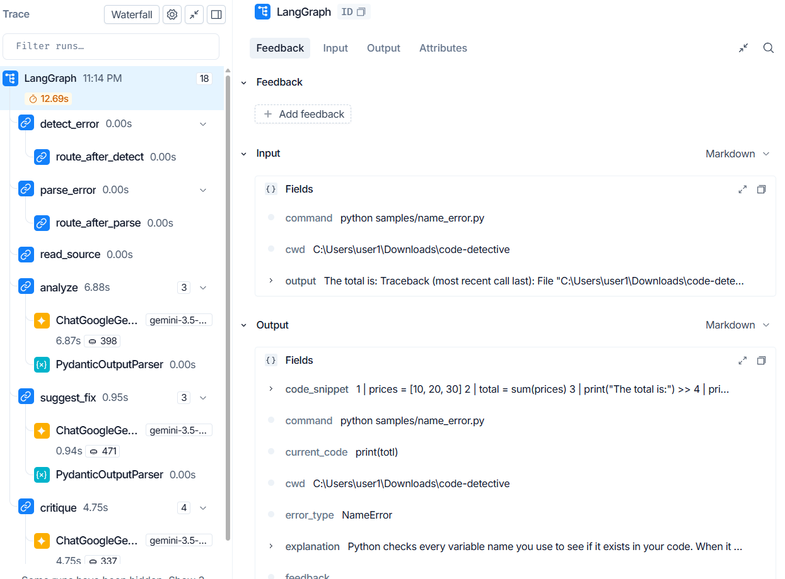

### 💡 Insight from the traces: more information created a new kind of mistake
In v2 I added `read_source` so the agent sees the code, not only the error message. Most metrics went up, but `fix_correct` **dropped** on `key_error.py`.
The trace showed why: the code prints `student["age"]`, but the dictionary only has `"name"` and `"grade"`.

| | v1 (did not see the code) | v2 (saw the code) |
|---|---|---|
| Fix | `print(student.get("age"))` | `print(student["grade"])` |
| Judge | ✅ | ❌ |

v2 saw which keys exist and "fixed" the error by replacing `age` with `grade`. The error disappears, but now the program prints **a grade instead of an age.** The model tried to make the error go away at any cost instead of keeping what I meant to do.

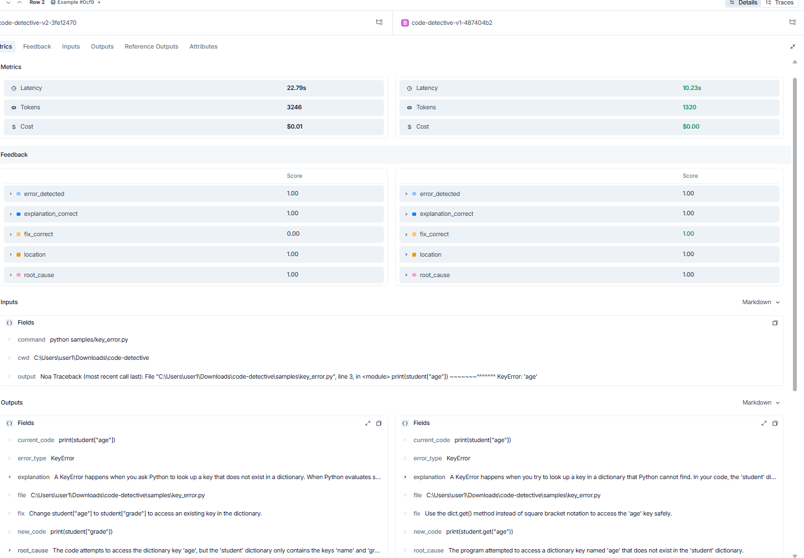

**The improvement (v3):** a new prompt rule ("keep what the student meant to do; don't swap in another variable or key just to make the error disappear") and a matching reviewer check. In v3 this example scored ✅.

**Conclusion:** more information does not automatically mean better results. It can open new ways for the model to be wrong, and you only see that by opening the trace itself, not from the average.

---

## 📊 Automatic evaluation: before and after

**Dataset:** 18 examples. Most are small scripts in `samples/` with a known bug, really run to get the real output:
12 Python errors, 4 errors in the command itself (`pyhton`, `pip install pandaz`, `git push` outside a repository, a script that does not exist), and 2 commands without an error. One of them is a **trap** that prints "0 errors found".

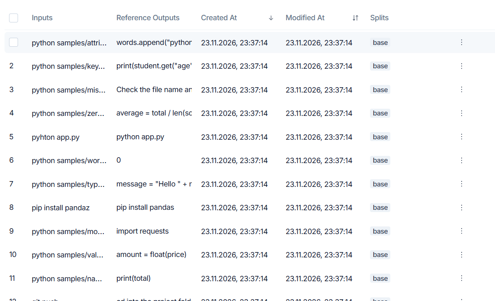

**Evaluators:**

| Evaluator | Type | What it checks |
|---|---|---|
| `error_detected` | code | did the agent correctly decide whether there is an error |
| `location` | code | are the file and line correct |
| `root_cause` | LLM-as-judge | is the root cause correct |
| `fix_correct` | LLM-as-judge | does the fix really solve it |
| `explanation_correct` | LLM-as-judge | does the explanation contain a false claim |

> In automatic evaluation nobody can click a button, so `run_experiment.py` always answers the interrupt with "solution". This produces a full fix that can be scored.

**Three versions of the same graph,** with different "switches" (`VERSIONS` in `graph.py`):

| Experiment | What the agent does | Sum of scores (out of 5) |
|---|---|---|
| `v1` (before) | searches for words like "error", does not read the code, no reviewer | **4.39** |
| `v2` | real error patterns, reads the code, reviewer + loop, accuracy rules in prompts | **4.70** |
| `v3` (after) | like v2, plus keeps the intent, checks commands really work, and "thinks" less (`thinking_level="low"`) | **4.82** |

| Metric | v1 | v2 | v3 |
|---|---|---|---|
| `error_detected` | 0.89 | 1.00 | **1.00** |
| `root_cause` | 0.78 | 1.00 | **1.00** |
| `location` | 1.00 | 0.94 | **1.00** |
| `explanation_correct` | 0.83 | 0.83 | **0.94** |
| `fix_correct` | 0.89 | **0.94** | 0.88 |

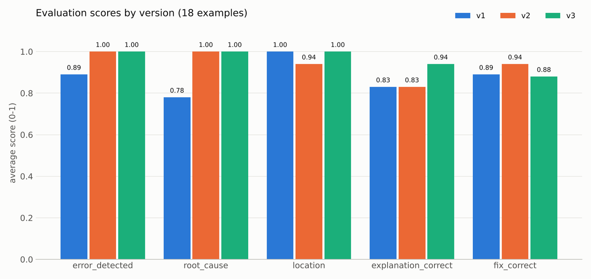

The v1 experiment in LangSmith. Row 3 (`missing.py`) and row 6 (`works.py`) are almost all 0 because `detect_error` was wrong:

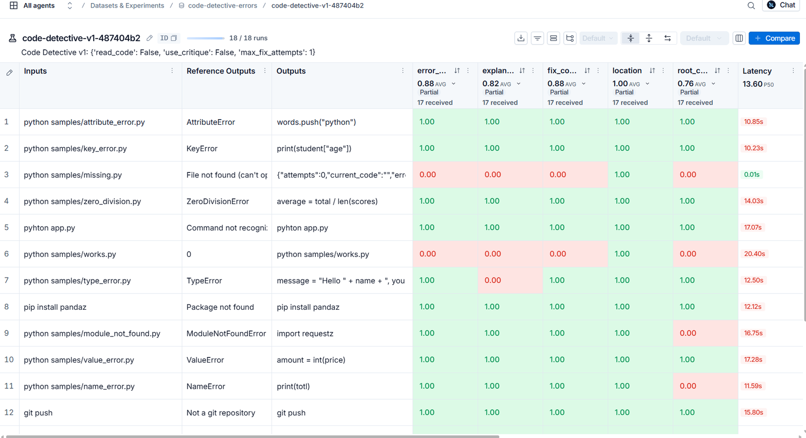

### ⏱️ Time, tokens and cost

| | v1 | v2 | v3 |
|---|---|---|---|
| Median time per example | 13.6 s | ~16 s | **11.1 s** |
| Tokens for the whole experiment | ~26K | ~55K | **26.6K** |
| Cost of the whole experiment | ~6.5¢ | ~15¢ | **3.7¢** |

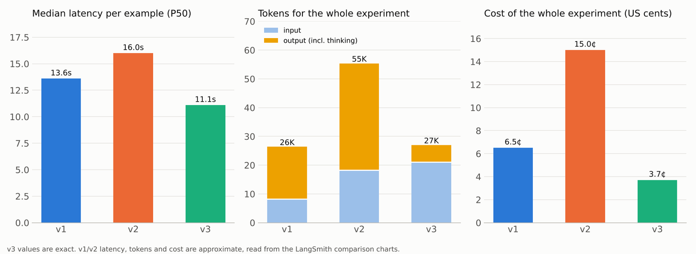

*v3 values are exact. v1 and v2 values were read from the comparison charts, so they are approximate.*

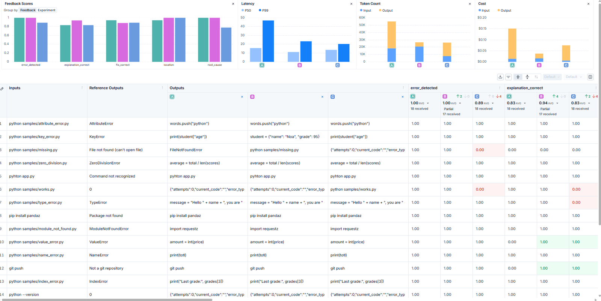

**Conclusion:** v3 is the most accurate, the fastest and the cheapest. In v2 most tokens were the model's "thinking" (~37K output tokens although the answers are short). With `thinking_level="low"` output dropped to ~5.8K and accuracy did **not** drop. It even went up.

### 🔎 More things I found in the traces

| What I saw | Why it happened | What I changed |
|---|---|---|
| "0 **error**s found" was flagged, "can't open file" was missed | `detect_error` searched for words anywhere in the output | search by the **shapes** of error messages, e.g. a line that starts with `NameError:` |
| The explanation said "Python gets confused" | the prompt asked for "simple", not "accurate" | rule: simple **and** technically accurate |
| The root cause just repeated the error message | the prompt asked "what", not "why" | rule with an example: "'totl' is a typo of 'total'" |
| The judge rejected "Python gets confused" in one example and accepted it in another | the judge is a model too | noted as a limitation: with 18 examples each one is worth ~6% |

| The judge on "Python gets confused" | The judge on a root cause that repeats the message |
|---|---|
| 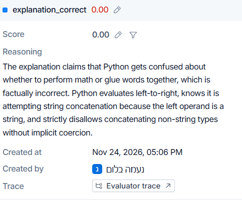 | 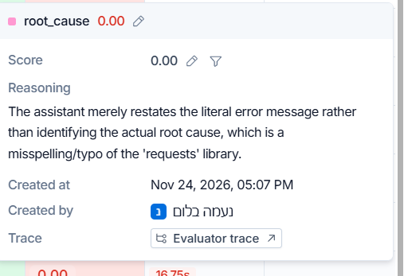 |

---

## 🪟 The window

- Pops up **by itself** on the right side of the screen about 1-2 seconds after the error with "analyzing the error...", and fills in the explanation when it is ready.
- All text is **in Hebrew**, right to left. Code and error names stay in English.
- **"💪 I'll fix it myself"** gives a hint. **"🔧 Give me the solution"** gives "now written" / "change to" with a copy button.
- Closing it with ✕ only **hides** it, and the next error opens it again. The "כיבוי" (off) button stops the agent.
- It has its own taskbar icon, and only one copy ever runs.
- The window uses v3.

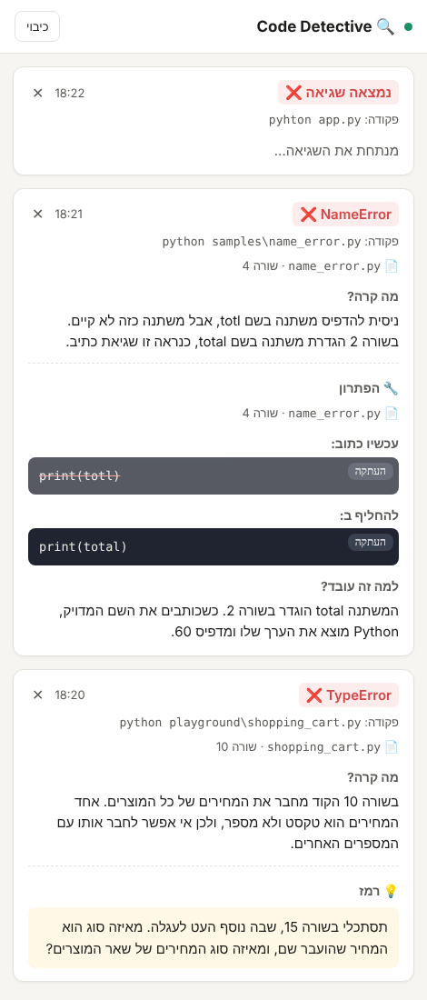

*The window with sample content: a card that is still analyzing, a full solution, and a hint.*

---

## 🛠️ Useful commands

After the setup ("🚀 Before you start" above), with `(.venv)` active:

- `python graph.py`: terminal test that stops and asks `[1]` hint or `[2]` solution
- `python watcher.py --test`: prints every command the watcher catches
- `python create_dataset.py`: creates the dataset in LangSmith (once, needs a LangSmith key)
- `python run_experiment.py v1` / `v2` / `v3`: runs an experiment (needs a LangSmith key)
- **The window:** opens by itself with every new PowerShell window, or manually with `python detective_app.py`

## 📁 Files

| File | Role |
|---|---|
| `graph.py` | the graph: State, nodes, routing, interrupt, the three versions |
| `prompts.py` | all prompts, including the v2 and v3 rules |
| `watcher.py` | reads the PowerShell logs and returns every finished command |
| `detective_app.py` | the window: runs the graph on each command and pops up on errors |
| `ui.html` | the window's design, in Hebrew, right to left |
| `icon.ico` | the agent's icon |
| `create_dataset.py` | builds the dataset and uploads it to LangSmith |
| `evaluators.py` | the five evaluators |
| `run_experiment.py` | runs an experiment for the chosen version |
| `samples/` | the broken scripts of the dataset |
| `screenshots/` | the README images |

## ⚠️ Limitations
- **Small dataset** (18 examples) and a judge that is itself a model, so a change in one example is not always meaningful.
- **v3 still fails on:** `missing.py` (explanation and fix) and `git push` (fix).
- **During automatic evaluation** the interrupt is always answered with "solution", so hints were not evaluated.
- **Windows only,** because it depends on PowerShell.

## 🔒 Privacy
Command output and code snippets from the files are sent to Gemini and stored in LangSmith traces. The keys are in `.env`, which is not committed to git.
