# 🔍 Code Detective: סוכן שמזהה ומסביר שגיאות בטרמינל

סוכן AI שיושב על PowerShell. כשפקודה נכשלת, **חלונית קופצת לבד** בצד המסך, ומסבירה בעברית פשוטה מה קרה, באיזה קובץ ובאיזו שורה.
אחר כך הוא שואל: **"אתקן לבד"** (ואז מקבלים רמז) או **"תביאי פתרון"** (ואז מקבלים את הקוד המתוקן). **הסוכן אף פעם לא משנה קבצים בעצמו.**

נבנה עם **LangGraph**, **LangChain**, **Gemini** ו-**LangSmith**.

[English version](README.en.md)

---

## 🚀 לפני שמתחילים: התקנה במחשב חדש

> הפרויקט עובד **רק ב-Windows**, וצריך **Python 3.10 ומעלה** ([להורדה](https://www.python.org/downloads/), ובהתקנה מסמנים *Add python.exe to PATH*).

הקובץ `requirements.txt` מתקין רק את החבילות של Python. כדי שהסוכן יעבוד, צריך לעשות עוד כמה דברים **פעם אחת**:

| # | מה עושים | למה |
|---|---|---|
| 1 | סביבה וירטואלית והתקנת החבילות | כדי שיהיו בדיוק אותן חבילות ואותן גרסאות |
| 2 | יצירת קובץ `.env` עם מפתח Gemini **משלך** | המפתחות לא עולים ל-GitHub |
| 3 | אישור ל-PowerShell להריץ את ה-profile | בהרבה מחשבים זה חסום כברירת מחדל |
| 4 | הוספת השורות של Code Detective ל-profile | הן מקליטות כל חלון PowerShell ומפעילות את הסוכן |

### 1️⃣ סביבה וירטואלית וחבילות
פותחים PowerShell בתוך תיקיית הפרויקט ומריצים:
```powershell
python -m venv .venv
.venv\Scripts\activate
pip install -r requirements.txt
```

### 2️⃣ קובץ `.env`
יוצרים בתיקיית הפרויקט קובץ בשם `.env`, עם התוכן הזה:
```
GOOGLE_API_KEY=המפתח-שלך
LANGSMITH_TRACING=false
```
- **מפתח Gemini בחינם:** [aistudio.google.com](https://aistudio.google.com) ← Get API key.
- **LangSmith הוא לא חובה.** הוא רק שומר traces. מי שרוצה אותו מוסיפה `LANGSMITH_TRACING=true`, ‏`LANGSMITH_API_KEY=...` ו-`LANGSMITH_PROJECT=code-detective`.

### 3️⃣ אישור ל-PowerShell להריץ את ה-profile
```powershell
Set-ExecutionPolicy -Scope CurrentUser RemoteSigned
```
עונים `Y`. ההגדרה מתירה להריץ סקריפטים שנוצרו במחשב הזה, רק למשתמש שלך.

### 4️⃣ השורות של Code Detective ב-profile
```powershell
if (-not (Test-Path $PROFILE)) { New-Item -Path $PROFILE -ItemType File -Force }
notepad $PROFILE
```
בפנקס הרשימות מדביקים את השורות האלה ושומרים. **אם הפרויקט לא נמצא ב-`Downloads\code-detective`,** משנים את השורה של `$ProjectDir` לנתיב של התיקייה:

```powershell
# ================= Code Detective =================
$DetectiveDir = "$HOME\detective"
$ProjectDir   = "$HOME\Downloads\code-detective"

# 1) Record this PowerShell window to its own log file
New-Item -ItemType Directory -Force -Path "$DetectiveDir\logs" | Out-Null
$logFile = "$DetectiveDir\logs\session-$(Get-Date -Format 'yyyyMMdd-HHmmss')-$PID.log"
Start-Transcript -Path $logFile | Out-Null

# 2) Start the agent in the background (only one copy runs)
$app = "$ProjectDir\detective_app.py"
$pythonw = "$ProjectDir\.venv\Scripts\pythonw.exe"
if ((Test-Path $app) -and (Test-Path $pythonw)) {
    Start-Process -FilePath $pythonw -ArgumentList "`"$app`"" -WorkingDirectory $ProjectDir -WindowStyle Hidden
}
# ==================================================
```

### ✅ בדיקה
1. סוגרים את כל חלונות PowerShell ופותחים **חלון חדש**.
2. מחכים כ-10 שניות, כי הסוכן נטען ברקע.
3. מריצים `python -c "1/0"`. אחרי שנייה-שתיים החלונית של Code Detective אמורה לקפוץ בצד ימין של המסך.

> אם היא לא קופצת, היומן של הסוכן נמצא ב-`notepad $HOME\detective\app.log`.

---

## 🧭 איך זה עובד

| שלב | מה קורה |
|---|---|
| ⌨️ PowerShell | עובדים כרגיל, בלי לשנות שום פקודה. ה-profile מקליט כל חלון לקובץ יומן משלו (`Start-Transcript`) |
| 👀 הצופה (`watcher.py`) | קורא את קובצי היומן כל רבע שנייה. פקודה נחשבת גמורה כשמופיעה שורת `PS ...>` חדשה, או אחרי שנייה בלי פלט חדש |
| 🧠 הגרף (`graph.py`) | מזהה אם יש שגיאה, מוצא קובץ ושורה, קורא את הקוד, מסביר, ומציע תיקון |
| 🪟 החלונית (`detective_app.py`) | קופצת מיד כשמזוהה שגיאה, עם "מנתחת...", וממלאת את ההסבר כשהוא מוכן |

---

## 🗺️ מבנה הגרף

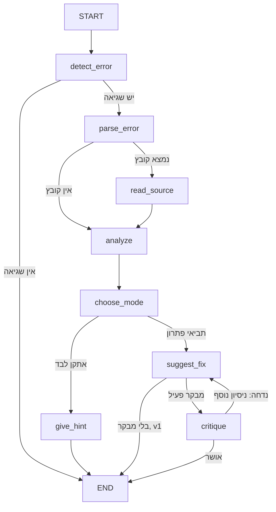

| תחנה | מה היא עושה | מודל? |
|---|---|---|
| `detect_error` | מחליטה אם בפלט יש שגיאה, לפי התבניות של הודעות שגיאה אמיתיות | לא, קוד |
| `parse_error` | מוצאת קובץ ושורה מתוך ה-Traceback, עם regex | לא, קוד |
| `read_source` | קוראת 5 שורות לפני השורה השגויה ו-5 אחריה | לא, קוד |
| `analyze` | סוג השגיאה, הסיבה, והסבר פשוט | ✅ |
| `choose_mode` | ✋ `interrupt`: עוצרת ושואלת: לבד או פתרון | לא |
| `give_hint` | רמז שמכוון למקום הנכון, בלי לתת את התשובה | ✅ |
| `suggest_fix` | פתרון מלא: קובץ, שורה, "עכשיו כתוב", "להחליף ב", ולמה זה עובד | ✅ |
| `critique` | מבקר שבודק את הפתרון, ומחזיר אותו לתיקון אם הוא לא טוב | ✅ |

---

## ✅ איך הפרויקט עונה על הדרישות

| דרישה | איפה בפרויקט |
|---|---|
| שימוש ב-LangGraph | `graph.py`: ‏`StateGraph` עם 8 תחנות |
| ענף מותנה | 3 ענפים: אחרי `detect_error` (שגיאה או לא), אחרי `parse_error` (קובץ או לא), אחרי `choose_mode` (רמז או פתרון) |
| לולאה | `critique → suggest_fix` כשהמבקר דוחה, עם מגבלת ניסיונות (`max_fix_attempts`) כדי שהלולאה לא תהיה אינסופית |
| interrupt ו-human-in-the-loop | `choose_mode` עוצר עם `interrupt()`. ממשיכים עם `Command(resume=...)`. ה-checkpointer הוא `MemorySaver` |
| Dataset והערכה ב-LangSmith, לפני ואחרי | `create_dataset.py` (18 דוגמאות), `evaluators.py` (5 מעריכים), `run_experiment.py` (v1, v2, v3) |
| README עם traces ותובנה | המסמך הזה 🙂 |

> 💡 **החלטת עיצוב:** הסוכן **לא מתקן לבד.** כל המטרה היא שאבין את השגיאה, ולא רק שהיא תיעלם. לכן ההחלטה אצלי: רמז כשאני רוצה לנסות לבד, ופתרון מלא כשאני תקועה.

---

## 🎥 Traces מ-LangSmith

### ✋ ה-interrupt בפעולה
הגרף עוצר ב-`choose_mode` ושואל. כאן נבחר `2` (פתרון), ולכן הוא המשיך ל-`suggest_fix` ול-`critique`. פקודה בלי שגיאה עוצרת מיד אחרי `detect_error`.

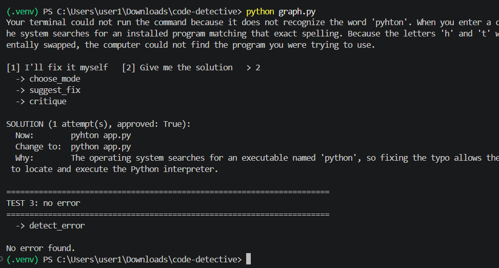

### כל עצירה מחלקת את ההרצה לשני traces
ה-trace השני מתחיל מ-`{"goto":[], ..., "resume": ...}`. זה ה-`Command(resume=...)` שנושא את הבחירה שלי, והגרף ממשיך ממנו בדיוק מאותה נקודה.

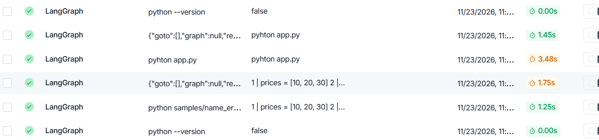

### 🌿 הענף: `read_source`
נמצא קובץ, ולכן הגרף עבר דרך `read_source`. ב-`code_snippet` רואים את הסימון `>> 4` על השורה השגויה. כמעט כל הזמן הולך על הקריאות למודל (✦), ושאר התחנות לוקחות 0 שניות.

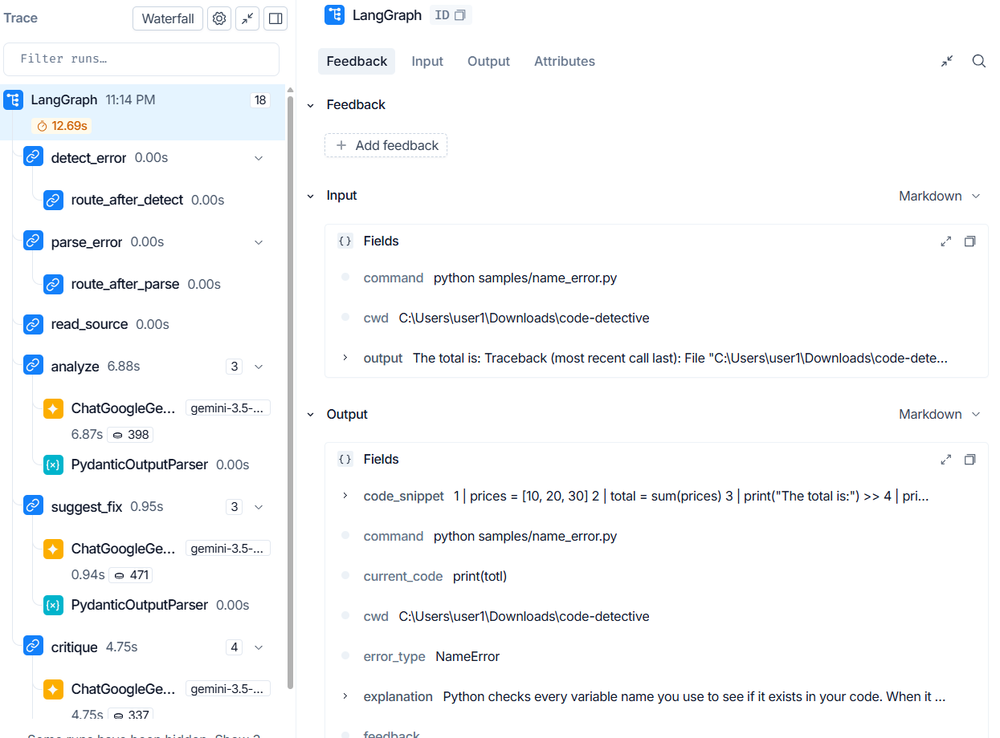

### 💡 התובנה מה-traces: יותר מידע יצר סוג חדש של טעות
ב-v2 הוספתי את `read_source`, כדי שהסוכן יראה את הקוד ולא רק את הודעת השגיאה. רוב המדדים עלו, אבל `fix_correct` **ירד** ב-`key_error.py`.
ב-trace ראיתי למה: הקוד מדפיס `student["age"]`, אבל במילון יש רק `"name"` ו-`"grade"`.

| | v1 (לא ראה את הקוד) | v2 (ראה את הקוד) |
|---|---|---|
| התיקון | `print(student.get("age"))` | `print(student["grade"])` |
| השופט | ✅ | ❌ |

v2 ראה אילו מפתחות קיימים, ו"תיקן" את השגיאה על ידי החלפת `age` ב-`grade`. השגיאה נעלמת, אבל עכשיו התוכנית מדפיסה **ציון במקום גיל.** המודל ניסה להעלים את השגיאה בכל מחיר, במקום לשמור על מה שהתכוונתי לעשות.

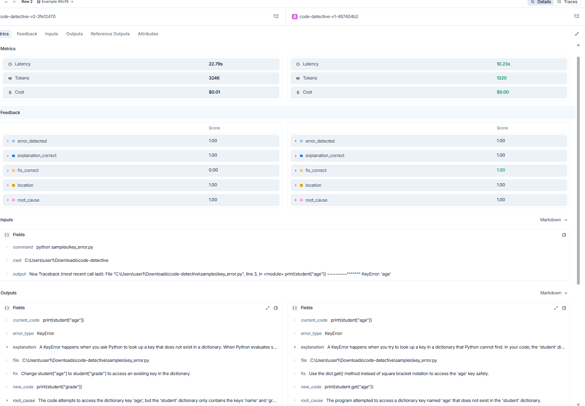

**השיפור (v3):** כלל חדש בפרומפט, "שמרי על מה שהתלמידה התכוונה לעשות, ואל תחליפי משתנה או מפתח רק כדי להעלים את השגיאה", ובדיקה מתאימה אצל המבקר. ב-v3 הדוגמה הזו קיבלה ✅.

**המסקנה:** יותר מידע לא אומר אוטומטית תוצאה טובה יותר. הוא יכול לפתוח למודל דרכים חדשות לטעות, ואת זה רואים רק כשנכנסים ל-trace עצמו, ולא מהממוצע.

---

## 📊 הערכה אוטומטית: לפני ואחרי שיפור

**Dataset:** ‏18 דוגמאות. רובן סקריפטים קטנים בתיקייה `samples/` עם באג ידוע, שמורצים באמת כדי לקבל את הפלט האמיתי:
12 שגיאות Python, 4 שגיאות בפקודה עצמה (`pyhton`, `pip install pandaz`, `git push` מחוץ למאגר, וסקריפט שלא קיים), ו-2 פקודות תקינות. אחת מהן היא **מלכודת** שמדפיסה "0 errors found".

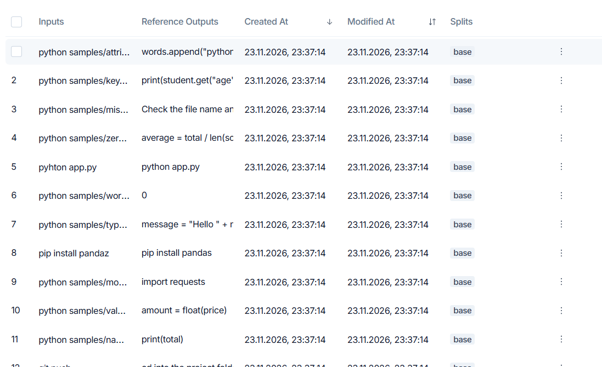

**Evaluators:**

| מעריך | סוג | מה הוא בודק |
|---|---|---|
| `error_detected` | קוד | האם הסוכן החליט נכון אם יש שגיאה |
| `location` | קוד | האם הקובץ והשורה נכונים |
| `root_cause` | LLM-as-judge | האם הסיבה נכונה |
| `fix_correct` | LLM-as-judge | האם התיקון באמת פותר |
| `explanation_correct` | LLM-as-judge | האם יש בהסבר טענה שגויה |

> בהערכה אוטומטית אין מי שילחץ על כפתור, ולכן `run_experiment.py` עונה ל-interrupt אוטומטית "solution". כך נוצר פתרון מלא שאפשר לתת לו ציון.

**שלוש גרסאות של אותו גרף,** עם "מתגים" שונים (`VERSIONS` ב-`graph.py`):

| ניסוי | מה הסוכן עושה | סכום ציונים (מתוך 5) |
|---|---|---|
| `v1` (לפני) | מחפש מילים כמו "error", לא קורא את הקוד, בלי מבקר | **4.39** |
| `v2` | תבניות שגיאה אמיתיות, קורא את הקוד, מבקר ולולאה, פרומפטים עם כללי דיוק | **4.70** |
| `v3` (אחרי) | כמו v2, ובנוסף שומר על הכוונה, בודק שפקודה באמת תעבוד, ו"חושב" פחות (`thinking_level="low"`) | **4.82** |

| מדד | v1 | v2 | v3 |
|---|---|---|---|
| `error_detected` | 0.89 | 1.00 | **1.00** |
| `root_cause` | 0.78 | 1.00 | **1.00** |
| `location` | 1.00 | 0.94 | **1.00** |
| `explanation_correct` | 0.83 | 0.83 | **0.94** |
| `fix_correct` | 0.89 | **0.94** | 0.88 |

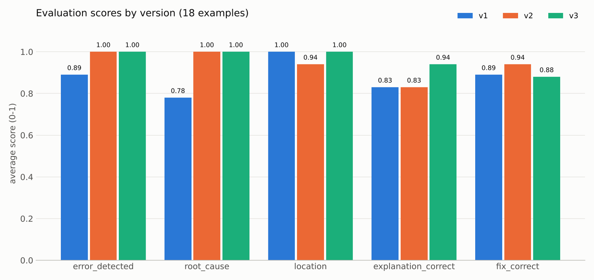

הניסוי של v1 ב-LangSmith. בשורה 3 (`missing.py`) ובשורה 6 (`works.py`) כמעט הכול 0, כי `detect_error` טעה:

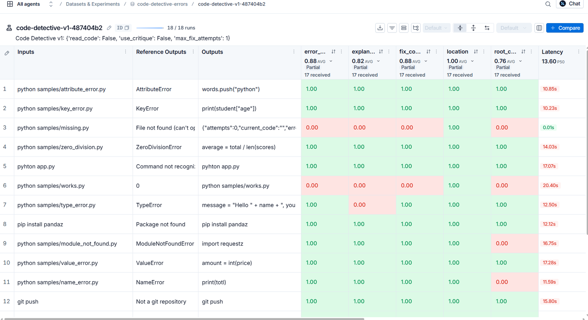

### ⏱️ זמן, טוקנים ועלות

| | v1 | v2 | v3 |
|---|---|---|---|
| זמן חציוני לדוגמה | 13.6 שנ׳ | כ-16 שנ׳ | **11.1 שנ׳** |
| טוקנים לכל הניסוי | כ-26K | כ-55K | **26.6K** |
| עלות לכל הניסוי | כ-6.5 סנט | כ-15 סנט | **3.7 סנט** |

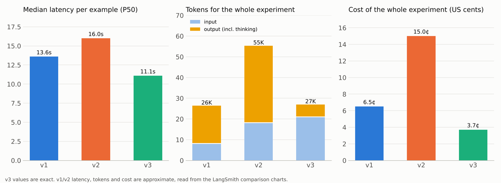

*הערכים של v3 מדויקים. את הערכים של v1 ו-v2 קראתי מהגרפים במסך ההשוואה, ולכן הם מקורבים.*

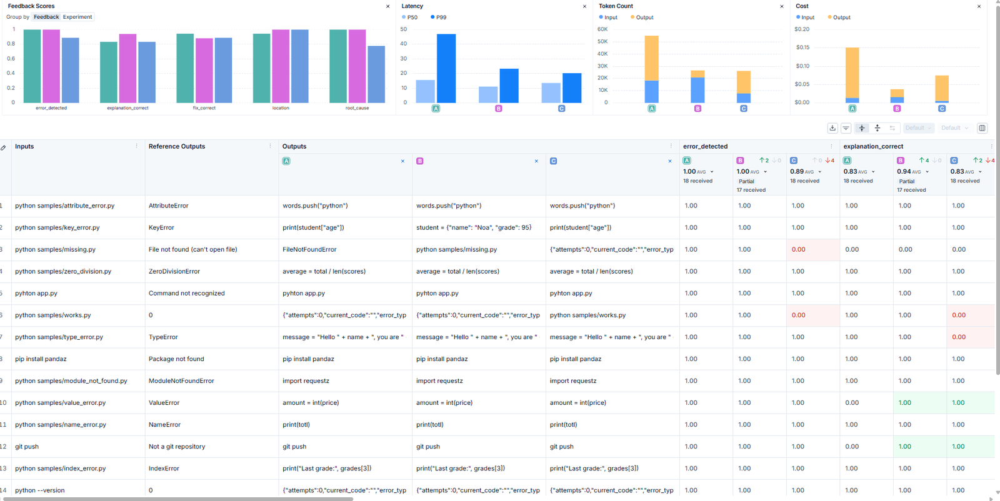

**המסקנה:** v3 הוא הכי מדויק, הכי מהיר והכי זול. ב-v2 רוב הטוקנים היו ה"חשיבה" של המודל (כ-37K טוקנים בפלט, למרות שהתשובות קצרות). עם `thinking_level="low"` הפלט ירד לכ-5.8K, והדיוק **לא** נפגע. הוא אפילו עלה.

### 🔎 עוד דברים שגיליתי ב-traces

| מה ראיתי | למה זה קרה | מה שיניתי |
|---|---|---|
| "0 **error**s found" זוהה כשגיאה, ו-"can't open file" לא זוהה | `detect_error` חיפש מילים בכל מקום בפלט | חיפוש לפי **צורות** של הודעות שגיאה, למשל שורה שמתחילה ב-`NameError:` |
| ההסבר כתב ש-"Python מתבלבל" | הפרומפט ביקש "פשוט" ולא ביקש "מדויק" | כלל: פשוט **וגם** מדויק טכנית |
| הסיבה רק חזרה על הודעת השגיאה | הפרומפט ביקש "מה" ולא "למה" | כלל עם דוגמה: "totl הוא שגיאת כתיב של total" |
| השופט פסל "Python מתבלבל" בדוגמה אחת וקיבל אותו באחרת | גם השופט הוא מודל | כתבתי את זה כמגבלה: עם 18 דוגמאות, כל דוגמה שווה כ-6% |

| השופט על "Python gets confused" | השופט על סיבה שרק חוזרת על ההודעה |
|---|---|
| 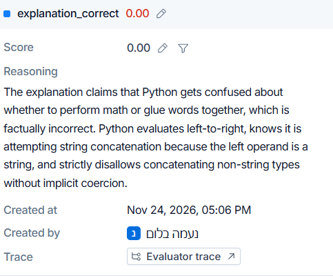 | 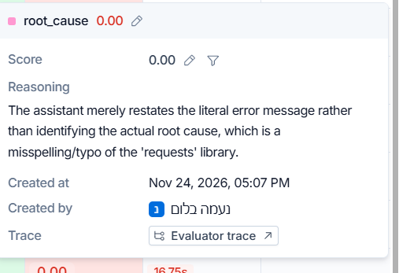 |

---

## 🪟 החלונית

- קופצת **לבד** בצד ימין של המסך, כשנייה עד שתיים אחרי השגיאה, עם "מנתחת את השגיאה...", וההסבר מתמלא כשהוא מוכן.
- כל הטקסט **בעברית,** מימין לשמאל. הקוד ושמות השגיאות נשארים באנגלית.
- **"💪 אתקן לבד"** נותן רמז. **"🔧 תביאי פתרון"** נותן "עכשיו כתוב" ו"להחליף ב", עם כפתור העתקה.
- סגירה ב-✕ רק **מסתירה** את החלונית. בשגיאה הבאה היא קופצת שוב. הכפתור "כיבוי" עוצר את הסוכן.
- יש לה אייקון משלה בשורת המשימות, ורק עותק אחד שלה רץ בכל רגע.
- החלונית משתמשת ב-v3.

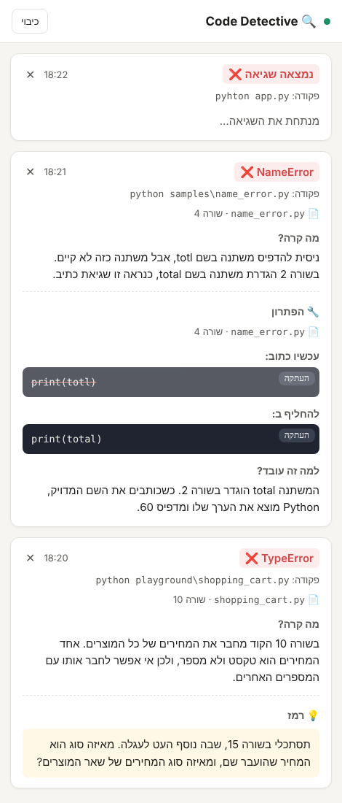

*בתמונה: החלונית עם תוכן לדוגמה. למעלה כרטיס שעדיין מנתח, באמצע פתרון מלא, ולמטה רמז.*

---

## 🛠️ פקודות שימושיות

אחרי ההתקנה (בחלק "🚀 לפני שמתחילים" למעלה), עם `(.venv)` פעיל:

- `python graph.py`: בדיקה בטרמינל. עוצר ושואל `[1]` רמז או `[2]` פתרון
- `python watcher.py --test`: מדפיס כל פקודה שהצופה קולט
- `python create_dataset.py`: יוצר את ה-dataset ב-LangSmith (פעם אחת, צריך מפתח LangSmith)
- `python run_experiment.py v1` / `v2` / `v3`: מריץ ניסוי (צריך מפתח LangSmith)
- **החלונית:** נפתחת לבד עם כל חלון PowerShell חדש. אפשר גם להריץ ידנית: `python detective_app.py`

## 📁 קבצים

| קובץ | תפקיד |
|---|---|
| `graph.py` | הגרף: State, תחנות, ניתוב, interrupt, שלוש הגרסאות |
| `prompts.py` | כל הפרומפטים, כולל הכללים של v2 ו-v3 |
| `watcher.py` | קורא את יומני PowerShell ומחזיר כל פקודה שהסתיימה |
| `detective_app.py` | החלונית: מריצה את הגרף על כל פקודה וקופצת כשיש שגיאה |
| `ui.html` | העיצוב של החלונית, בעברית ומימין לשמאל |
| `icon.ico` | האייקון של הסוכן |
| `create_dataset.py` | בונה את ה-dataset ומעלה אותו ל-LangSmith |
| `evaluators.py` | חמשת המעריכים |
| `run_experiment.py` | מריץ ניסוי לגרסה שבוחרים |
| `samples/` | הסקריפטים השבורים של ה-dataset |
| `screenshots/` | התמונות של ה-README |

## ⚠️ מגבלות
- **Dataset קטן** (18 דוגמאות) ושופט שהוא בעצמו מודל, ולכן שינוי בדוגמה אחת לא תמיד משמעותי.
- **ב-v3 עדיין יש כשלונות:** `missing.py` (הסבר ותיקון) ו-`git push` (תיקון).
- **בהערכה האוטומטית** ה-interrupt נענה תמיד "solution", ולכן הרמזים לא נבדקו בניסויים.
- **הסוכן עובד רק ב-Windows,** כי הוא תלוי ב-PowerShell.

## 🔒 פרטיות
הפלט של הפקודות וקטעי קוד מהקבצים נשלחים ל-Gemini, ונשמרים ב-traces של LangSmith. המפתחות נמצאים ב-`.env`, והוא לא עולה לגיט.
